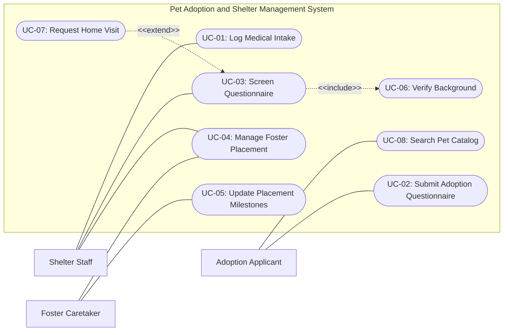
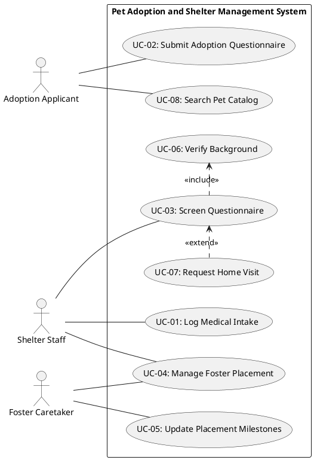

# Lab 1: Requirements Engineering and UML Use-Case Modelling

## Problem Statement 57: Pet Adoption and Shelter Management System

### 1. Problem Context and Overview
An animal shelter management portal tracks rescue medical intake histories. The system screens prospective adopter questionnaires. The system also manages foster home placement timelines.

### 2. System Stakeholders and Actors
- **Adoption Applicant**: A person who searches for animals and submits adoption questionnaires.
- **Shelter Staff**: An employee who records medical intakes, screens questionnaires, and schedules foster placements.
- **Foster Caretaker**: A volunteer who hosts rescue animals and tracks placement milestone dates.

---

## 3. Requirements Specification

### Requirements Table

| Req ID | Type | Description | Priority | Acceptance Criteria | Rationale | Comments |
| :--- | :--- | :--- | :--- | :--- | :--- | :--- |
| **FR-001** | Functional | The system shall allow shelter staff to log animal vaccination and medical intake records. | High | **Pass**: The system links the verified medical record to the animal record and marks the status as Ready for Adoption. **Fail**: The system marks an animal under quarantine as adopted. | Medical history confirms that an animal is healthy before adoption. | Core intake functionality. |
| **FR-002** | Functional | The system shall allow an adoption applicant to submit an adoption questionnaire for an available animal. | High | **Pass**: The system stores the submitted questionnaire and assigns a unique application identifier. **Fail**: The system accepts an application with missing required fields. | Shelter staff requires applicant housing and pet history to evaluate compatibility. | Core applicant interaction. |
| **FR-003** | Functional | The system shall screen submitted adoption questionnaires against shelter eligibility criteria. | High | **Pass**: The system flags disqualified responses and notifies shelter staff within five seconds. **Fail**: The system approves a questionnaire that fails background criteria. | Automated screening accelerates application review. | Automates initial screening. |
| **FR-004** | Functional | The system shall allow shelter staff to schedule foster home placement timelines for rescue animals. | Medium | **Pass**: The system saves start dates, check-in dates, and expected return dates for an assigned foster home. **Fail**: The system allows overlapping foster schedules for the same animal. | Structured timelines prevent scheduling conflicts for foster animals. | Core shelter coordination. |
| **FR-005** | Functional | The system shall send reminder alerts to foster caretakers for upcoming placement milestones. | Medium | **Pass**: The system delivers an email notification forty-eight hours before a scheduled check-in date. **Fail**: The system fails to send a notification before a scheduled milestone. | Timely alerts keep foster caretakers on schedule for veterinary visits. | Improves milestone adherence. |
| **NFR-001** | Non-Functional | The system shall return pet search catalog results in less than 200 milliseconds under a load of 500 concurrent users. | High | **Pass**: Benchmark tests confirm response times below 200 milliseconds during peak load. **Fail**: Average page response time exceeds 200 milliseconds during peak load. | Fast search results prevent user drop-off on the public pet catalog. | Performance requirement. |
| **NFR-002** | Non-Functional | The system shall encrypt all stored applicant questionnaires and animal medical records at rest using AES-256 encryption. | High | **Pass**: A security audit confirms that database files store all applicant data in AES-256 encrypted form. **Fail**: Unencrypted personal data appears in database storage. | Encryption protects applicant privacy and prevents unauthorized data leaks. | Security requirement. |

---

## 4. UML Use-Case Diagram

### Diagram View (Mermaid)

### PlantUML Specification

An SVG version of this diagram is available at [use_case_diagram.svg](use_case_diagram.svg).

---

## 5. Use-Case Flow Specification

### Use Case Identifier: UC-02
**Use Case Name**: Submit Adoption Questionnaire  
**Primary Actor**: Adoption Applicant  
**Stakeholders**: Shelter Staff, Adoption Applicant  

### Preconditions
1. The adoption applicant navigates to the animal profile page.
2. The animal profile shows a status of Ready for Adoption.

### Postconditions
1. The system creates and stores the adoption questionnaire record.
2. The system sets the application status to Pending Review.
3. The system sends a confirmation email to the adoption applicant.

---

### Main Success Scenario

1. The adoption applicant clicks the Adopt button on the animal profile page.
2. The system displays the adoption questionnaire form.
3. The adoption applicant fills in personal contact details, housing type, and previous pet history.
4. The adoption applicant accepts the shelter adoption terms.
5. The adoption applicant clicks the Submit Application button.
6. The system validates all required form fields.
7. The system creates a new application record with a unique tracking identifier.
8. The system links the application record to the selected animal record.
9. The system sets the application status to Pending Review.
10. The system displays a submission confirmation message to the adoption applicant.
11. The system delivers a confirmation email with the tracking identifier to the adoption applicant.
12. The use case ends successfully.

---

### Alternate Flows

#### Alternate Flow 6a: Incomplete Form Submission
- **6a1**: The system detects missing or invalid values in the required form fields.
- **6a2**: The system highlights the invalid fields on the screen.
- **6a3**: The system displays an error message that instructs the adoption applicant to complete the highlighted fields.
- **6a4**: The adoption applicant corrects the highlighted fields and submits the form again.
- **6a5**: The flow returns to Step 6 of the Main Success Scenario.

#### Alternate Flow 6b: Animal Status Changed
- **6b1**: The system detects that the animal status changed to Adopted during form entry.
- **6b2**: The system blocks the submission.
- **6b3**: The system informs the adoption applicant that another applicant adopted the animal.
- **6b4**: The system displays a list of other available animals to the adoption applicant.
- **6b5**: The use case terminates.
