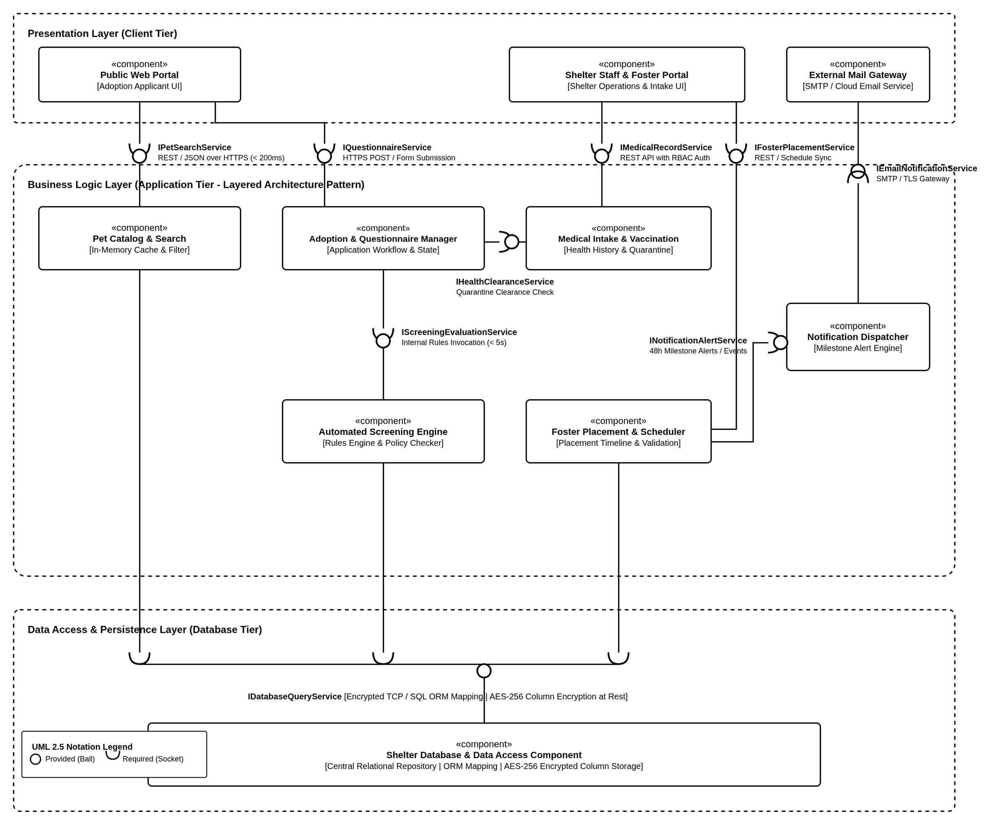

# Lab 3: Component Modelling & Architectural Pattern Selection

- **Course**: UE24CS341A – Software Engineering
- **Student Name**: Andey Hemanth
- **SRN**: PES2UG24CS061
- **Assigned Problem Statement**: Problem Statement 57: Pet Adoption and Shelter Management System

---

## 1. Executive Summary & Problem Context

The **Pet Adoption and Shelter Management System (Problem Statement 57)** is a specialized domain platform engineered to manage the end-to-end operational lifecycle of rescued animals. The system handles medical intake logging, public pet discovery, prospective adopter questionnaire evaluation, automated screening, and foster home placement scheduling with automated reminder workflows.

### 1.1 Context from Lab 1 and Lab 2

This architectural specification directly builds upon the requirements engineering and Agile backlog established in previous labs:

- **Lab 1 Requirements**:
    - **FR-001**: Animal vaccination and medical intake recording.
    - **FR-002**: Adoption questionnaire submission by prospective adopters.
    - **FR-003**: Automated questionnaire screening against shelter eligibility rules within 5 seconds.
    - **FR-004**: Foster placement timeline scheduling (start dates, check-ins, return dates).
    - **FR-005**: Foster placement milestone email reminders delivered 48 hours in advance.
    - **NFR-001**: Pet catalog search latency < 200 ms under 500 concurrent users.
    - **NFR-002**: AES-256 encryption at rest for all stored applicant questionnaires and medical records.

- **Lab 2 Agile Backlog**:
    - **Epic 1 (`SCRUM-5`)**: Animal Medical Intake & Status Management (`SCRUM-8`, `SCRUM-9`).
    - **Epic 2 (`SCRUM-6`)**: Adopter Application & Eligibility Screening (`SCRUM-10`, `SCRUM-11`).
    - **Epic 3 (`SCRUM-7`)**: Foster Placement & Milestone Tracking (`SCRUM-12`, `SCRUM-13`).

---

## 2. Architectural Style Comparative Evaluation

To determine the most suitable software architecture for the Pet Adoption and Shelter Management System, three candidate architectural patterns were evaluated: **Layered (3-Tier) Architecture**, **Microservices Architecture**, and **Client-Server Architecture**.

### 2.1 Architectural Comparison Matrix

| Evaluation Dimension | Layered (3-Tier) Architecture | Microservices Architecture | Client-Server Architecture |
| :--- | :--- | :--- | :--- |
| **Separation of Concerns** | **High**: Strict horizontal separation across Presentation, Business Logic, and Data Persistence layers. | **High**: Service-boundary modularity organized around domain subdomains. | **Low to Moderate**: Business logic frequently bleeds into client or database stored procedures. |
| **Data Consistency & Transactions** | **High (ACID)**: Centralized database ensures strict relational integrity and ACID transactions across medical clearance and adoption status. | **Low to Moderate (BASE)**: Requires complex distributed sagas, two-phase commits, or eventual consistency across services. | **High (ACID)**: Centralized database with direct connection pools. |
| **Operational & Deployment Complexity** | **Low**: Monolithic or multi-tier deployment on unified infrastructure; straightforward CI/CD pipelines. | **Very High**: Requires service meshes, distributed tracing, container orchestration (Kubernetes), and multi-repo CI/CD. | **Very Low**: Simple two-tier deployment; hard to manage version compatibility across client apps. |
| **Security & Privacy Enforcement (NFR-002)** | **High**: Centralized Data Access Layer uniformly enforces AES-256 encryption at rest and strict Role-Based Access Control (RBAC). | **Moderate**: Requires securing every inter-service gRPC/REST endpoint and managing distributed secrets/keys. | **Low to Moderate**: Direct client-to-server or DB access increases attack surface and perimeter exposure. |
| **Performance & Latency (NFR-001)** | **High**: In-memory caching (Redis) in the Application Tier easily delivers sub-200ms query times without network hop overhead. | **Moderate**: Network serialization and inter-service latency can degrade composite search performance. | **Moderate**: Server load spikes quickly degrade response times for public catalog queries. |
| **Development & Team Velocity** | **Optimal for Medium Teams**: Single coherent codebase with well-defined service boundaries and low overhead. | **High for Large Teams**: Overkill for shelter scale; excessive infrastructure management overhead. | **Fast Initial, Poor Long-term**: Quick prototype setup but prone to tight coupling. |

---

## 3. Architecture Selection & Technical Justification

> **Architectural Selection Declaration**:  
> **"I chose Layered (3-Tier) Architecture for the Pet Adoption and Shelter Management System."**

The **Layered Architecture** organizes the system into three primary horizontal tiers:

1. **Presentation Layer (Client Tier)**: Handles UI rendering, input sanitization, and RESTful API client requests.
2. **Business Logic Layer (Application Tier)**: Implements domain workflows, eligibility screening algorithms, medical clearance verifications, and foster timeline validations.
3. **Data Access & Persistence Layer (Database Tier)**: Manages ORM entities, connection pooling, and transparent AES-256 encrypted database persistence.

### 3.1 Concrete Technical Justifications

#### 1. Scenario Reason 1: Strict Separation of Public Discovery and Privileged Shelter Operations with Strong ACID Consistency

The shelter workflow has two fundamentally different operational profiles:

- Public applicants browse available pets (`FR-002`, `NFR-001`) and submit applications.
- Shelter staff and medical volunteers perform privileged intakes, administer vaccines, update quarantine statuses (`FR-001`), and lock animals into foster timelines (`FR-004`).

An animal cannot be marked *Ready for Adoption* or assigned to an adopter while undergoing medical quarantine or an active foster placement. The **Layered Architecture** provides atomic transaction boundaries within the Business Logic Tier, ensuring that medical clearance, questionnaire review, and status transitions occur under strict ACID guarantees without the failure modes or eventual consistency anomalies of distributed microservices.

#### 2. Scenario Reason 2: Operational Simplicity and High Maintainability for Shelter Scale

Animal shelters and rescue organizations operate with focused development teams and limited infrastructure budgets. A Microservices architecture introduces massive operational overhead (service meshes, distributed logging, network partition handling, and polyglot persistence). The **Layered Architecture** achieves clean modular encapsulation via well-defined internal component interfaces while keeping deployment, monitoring, and database management centralized, reliable, and cost-effective.

#### 3. Security Advantage: Centralized AES-256 Encryption at Rest and Strict RBAC Enforcement (NFR-002)

Adoption applications contain highly sensitive Personally Identifiable Information (PII) such as applicant home addresses, family details, income brackets, and landlord permissions (`FR-002`), while medical records contain confidential veterinary logs (`FR-001`). In this Layered Architecture:

- All database read/write operations must pass through the **Shelter Database & Data Access Component**.
- The Data Access Layer enforces transparent **AES-256 column-level encryption** for applicant PII and medical histories prior to disk persistence.
- Role-Based Access Control (RBAC) is enforced at the business layer gateway, ensuring public applicants can never query quarantine records or other applicants' screening data.

#### 4. Performance Benefit: Sub-200ms Catalog Search via Layer-Integrated In-Memory Caching (NFR-001)

To satisfy Non-Functional Requirement **NFR-001** (returning search results in < 200 ms under 500 concurrent users), the **Pet Catalog & Search Component** in the Application Tier incorporates an in-memory caching mechanism (e.g., Redis / Local Cache). Public search queries for available pets are served directly from cache memory in under 20 ms, bypassing database disk I/O. Write operations (medical status updates, adoptions) invalidate relevant cache keys atomically through internal service events.

---

## 4. Component Identification & Specifications

The system is decomposed into **7 modular components** across the three architectural layers. Each component encapsulates specific business logic, hides internal data structures, and communicates exclusively through explicit provided and required interfaces.

### 4.1 Component Catalog Table

| Component Name | Layer / Stereotype | Provided Interfaces | Required Interfaces | Core Responsibilities & Lab Mapping |
| :--- | :--- | :--- | :--- | :--- |
| **`Public Web Portal`** | Presentation (`<<component>>`) | *None (UI Client)* | `IPetSearchService`, `IQuestionnaireService` | Renders public responsive UI for adopters; captures filter criteria and submits questionnaires. |
| **`Shelter Staff & Foster Portal`** | Presentation (`<<component>>`) | *None (Staff UI)* | `IMedicalRecordService`, `IFosterPlacementService` | Renders administrative dashboards for medical logging, quarantine tracking, and foster timeline scheduling. |
| **`Pet Catalog & Search Component`** | Business (`<<component>>`) | `IPetSearchService` | `IShelterDataAccess` | Filters available pets by breed, age, and size; caches catalog data to fulfill NFR-001 (< 200 ms). |
| **`Adoption & Questionnaire Manager Component`** | Business (`<<component>>`) | `IQuestionnaireService` | `IScreeningEngine`, `IHealthClearance`, `INotificationDispatch` | Manages applicant questionnaire workflows, application tracking IDs, and state transitions (FR-002, SCRUM-10). |
| **`Automated Screening Engine`** | Business (`<<component>>`) | `IScreeningEngine` | `IShelterDataAccess` | Executes rule-based eligibility checks (< 5s), evaluates housing/pet policies, flags disqualifications (FR-003, SCRUM-11). |
| **`Medical Intake & Vaccination Component`** | Business (`<<component>>`) | `IMedicalRecordService`, `IHealthClearance` | `IShelterDataAccess` | Records vaccine logs, tracks medical history, enforces quarantine hold, updates adoption readiness (FR-001, SCRUM-8, SCRUM-9). |
| **`Foster Placement & Scheduler Component`** | Business (`<<component>>`) | `IFosterPlacementService` | `INotificationDispatch`, `IShelterDataAccess` | Manages foster schedules, prevents overlapping bookings, tracks milestone check-in dates (FR-004, SCRUM-12). |
| **`Notification Dispatcher Component`** | Business (`<<component>>`) | `INotificationDispatch` | `ISMTPClient` | Formats email templates, schedules automated 48-hour milestone reminders, and dispatches via SMTP (FR-005, SCRUM-13). |
| **`Shelter Database & Data Access Component`** | Data (`<<component>>`) | `IShelterDataAccess` | *None (Direct DB / ORM)* | Centralized persistence layer with ORM mapping, connection pooling, and AES-256 encryption at rest (NFR-002). |

---

## 5. Interface Specifications & Communication Protocols

In accordance with UML component modelling standards, components expose services via **Provided Interfaces (Ball / Lollipop notation)** and consume services via **Required Interfaces (Socket notation)**.

### 5.1 Interface Details

| Interface Name | Provider (Ball) | Consumer (Socket) | Protocol / Mechanism | Key Methods & Signatures |
| :--- | :--- | :--- | :--- | :--- |
| **`IPetSearchService`** | `Pet Catalog & Search` | `Public Web Portal` | REST / JSON over HTTPS | `searchPets(filterCriteria)` `getPetProfile(petId)` `getAvailableBreeds()` |
| **`IQuestionnaireService`** | `Adoption & Questionnaire Manager` | `Public Web Portal` | HTTPS POST / REST | `submitQuestionnaire(data)` `getApplicationStatus(appId)` `updateApplicationStatus(appId, status)` |
| **`IScreeningEngine`** | `Automated Screening Engine` | `Adoption & Questionnaire Manager` | Synchronous RPC / Service Call | `evaluateQuestionnaire(data)` `validateHousingRules(housing, breed)` `flagDisqualification(appId, reason)` |
| **`IMedicalRecordService`** | `Medical Intake & Vaccination` | `Shelter Staff & Foster Portal` | REST over HTTPS (RBAC Auth) | `logVaccination(animalId, vaccine)` `getMedicalHistory(animalId)` `updateAdoptionReadiness(animalId, flag)` |
| **`IHealthClearance`** | `Medical Intake & Vaccination` | `Adoption & Questionnaire Manager` | Synchronous Service Call | `verifyAdoptionReadiness(animalId)` `getQuarantineStatus(animalId)` |
| **`IFosterPlacementService`** | `Foster Placement & Scheduler` | `Shelter Staff & Foster Portal` | REST / JSON over HTTPS | `scheduleFosterTimeline(placement)` `validateNoOverlap(animalId, dates)` `getUpcomingMilestones(caretakerId)` |
| **`INotificationDispatch`** | `Notification Dispatcher` | `Foster Placement & Scheduler`, `Adoption Manager` | Asynchronous Queue / Event | `enqueueMilestoneReminder(alert)` `sendApplicationConfirmation(email, appId)` |
| **`ISMTPClient`** | `External Mail Gateway` | `Notification Dispatcher` | SMTP over TLS (Port 587) | `dispatchEmail(recipient, subject, bodyHtml)` |
| **`IShelterDataAccess`** | `Shelter Database & Data Access` | All Business Components | JDBC / JPA with AES-256 Engine | `saveEncryptedEntity(entity)` `findById(id, entityClass)` `executeOptimizedQuery(query)` |

---

## 6. UML Component Diagram

The following UML Component Diagram was authored in Draw.io and exported locally:

- **Vector Format (SVG)**: [component_diagram.svg](component_diagram.svg)
- **Editable Draw.io Source**: [component_diagram.drawio](component_diagram.drawio)

---

## 7. Requirements & Jira Backlog Traceability Matrix

This traceability matrix maps the architectural components and interfaces back to the Lab 1 requirements and Lab 2 Jira Agile backlog items, ensuring 100% architectural coverage.

| Requirement ID | Requirement Type | Jira Story Key | Implementing Component | Interface Utilized | Architectural Verification |
| :--- | :--- | :--- | :--- | :--- | :--- |
| **FR-001** | Functional | `SCRUM-8`, `SCRUM-9` | `Medical Intake & Vaccination Component` | `IMedicalRecordService`, `IHealthClearance` | Verified through medical intake logging, quarantine status updates, and adoption readiness checks. |
| **FR-002** | Functional | `SCRUM-10` | `Adoption & Questionnaire Manager Component` | `IQuestionnaireService` | Verified via online questionnaire submission endpoint, unique ID generation, and application status tracking. |
| **FR-003** | Functional | `SCRUM-11` | `Automated Screening Engine` | `IScreeningEngine` | Verified through automated policy evaluation rules executing within 5 seconds of questionnaire submission. |
| **FR-004** | Functional | `SCRUM-12` | `Foster Placement & Scheduler Component` | `IFosterPlacementService` | Verified by timeline validation logic blocking overlapping foster dates for the same animal. |
| **FR-005** | Functional | `SCRUM-13` | `Notification Dispatcher Component` | `INotificationDispatch`, `ISMTPClient` | Verified via asynchronous milestone scheduler dispatching email alerts 48 hours prior to check-ins. |
| **NFR-001** | Non-Functional | `SCRUM-10` | `Pet Catalog & Search Component` | `IPetSearchService` | Verified by in-memory caching layer returning catalog search results in < 200 ms under 500 concurrent users. |
| **NFR-002** | Non-Functional | `SCRUM-8`, `SCRUM-10` | `Shelter Database & Data Access Component` | `IShelterDataAccess` | Verified by transparent column-level AES-256 database encryption for applicant questionnaires and medical records. |

---

## 8. Conclusion & Architectural Reflection

By selecting the **Layered (3-Tier) Architectural Pattern**, the Pet Adoption and Shelter Management System achieves an optimal balance between **modularity**, **operational simplicity**, **data consistency**, and **stringent security**.

### Key Architectural Takeaways

1. **Coupling vs. Cohesion**: Decomposing the system into 7 focused components ensures high cohesion within domain modules while maintaining loose coupling through explicit ball-and-socket interfaces.

2. **Security by Design**: Isolating encryption logic within the Data Access Layer guarantees that AES-256 encryption at rest (NFR-002) is applied consistently across all data access pathways.

3. **Targeted Performance Optimization**: Incorporating caching within the Pet Catalog component allows the system to comfortably meet the sub-200ms response time requirement (NFR-001) without introducing distributed caching synchronization complexities.
